<div align="center">

# Usta

**Describe a building in plain words. Claude designs it, checks it and builds it in your Minecraft world.**

Minecraft Java 26.3 · Fabric · Claude (Opus, Sonnet, Haiku, Fable) · Windows

[Türkçe](README_TR.md)

<a href="docs/media/usta_tanitim.mp4">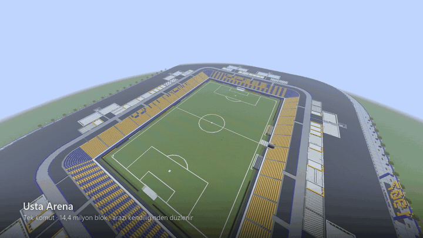</a>

[**▶ Watch the 1080p60 film**](docs/media/usta_tanitim.mp4)

</div>

---

## What it is

Usta ("master builder" in Turkish) connects Claude to a singleplayer Minecraft world. You type a request in chat,
in Turkish, the way you would ask a person:

```
/claude önüme bahçeli bir Osmanlı konağı yap
```
*("build an Ottoman mansion with a garden in front of me")*

Usta reads the world around you (terrain, water, existing buildings, where you are looking), picks a site, has Claude
write the building as a short script on top of a building kit, renders preview images, runs an automatic audit, and then
builds it in front of you. You can watch it go up block by block. Every build can be undone with one command.

It has two parts:

| part | where | what it does |
|---|---|---|
| Fabric mod | `mod/` (Java 25) | a local API on 127.0.0.1, a tick-budgeted build engine, persistent undo and redo, protected regions, the `/claude` and `/usta` commands |
| Python bridge | `bridge/usta/` | runs Claude through the Claude Code CLI, the building kit, the preview renderer, the auditor, and an MCP server with 38 tools |

## What it can do

- **Build anything you can describe.** Houses, mosques, castles, hotels, whole towns, farms, trees, vehicles.
  The kit has 72 components, 9 style packs, 30 interior recipes, 14 tree species, terrain tools, 7 redstone mechanisms
  and 19 parametric generators (house, modern villa, Ottoman konak, mosque, bridge, lighthouse, castle, skyscraper,
  city block, farm, windmill, Japanese garden, and more).
- **Pick the model and the effort.** By default a new building goes to Opus and a small edit to Sonnet. Put
  `!opus`, `!sonnet`, `!haiku` or `!fable` at the start to choose, and `!düşük`, `!orta`, `!yüksek`, `!çokyüksek` or
  `!max` for the thinking level: `/claude !opus !max önüme devasa bir saray yap`.
- **Check before it builds.** 36 automatic checks: support, walkable doors and stairs (with 3 blocks of head room),
  lighting, roofs, windows, palette, terrain and water. Claude fixes what it can before building and tells you
  about any finding it could not clear.
- **Edit what is already there.** "Add a floor", "where is the furniture?", "put doors in", "rebuild it properly":
  Usta finds the building you mean and changes it.
- **Undo everything.** `/usta geri` undoes the last job, including explosions. Big removals wait for one click of
  confirmation.
- **One command, 14.4 million blocks.** `/usta stadyum` builds a ready-made 705 × 589 arena with about
  105,000 seats in front of you, without calling Claude. It levels hills, fills holes and water, and moves aside if
  something is already standing there. `/usta stadyum zorla` builds exactly where you are.
- **Work from Claude Code too.** Say "in Minecraft, …" in any Claude Code session and it uses the same 38 MCP tools.

## Built in one world, in one day

These are real requests typed in chat and what Usta reported back. Prompts are in Turkish with a translation;
typos and swearing were cleaned up and some were shortened.

| | request | model | result |
|---|---|---|---|
| 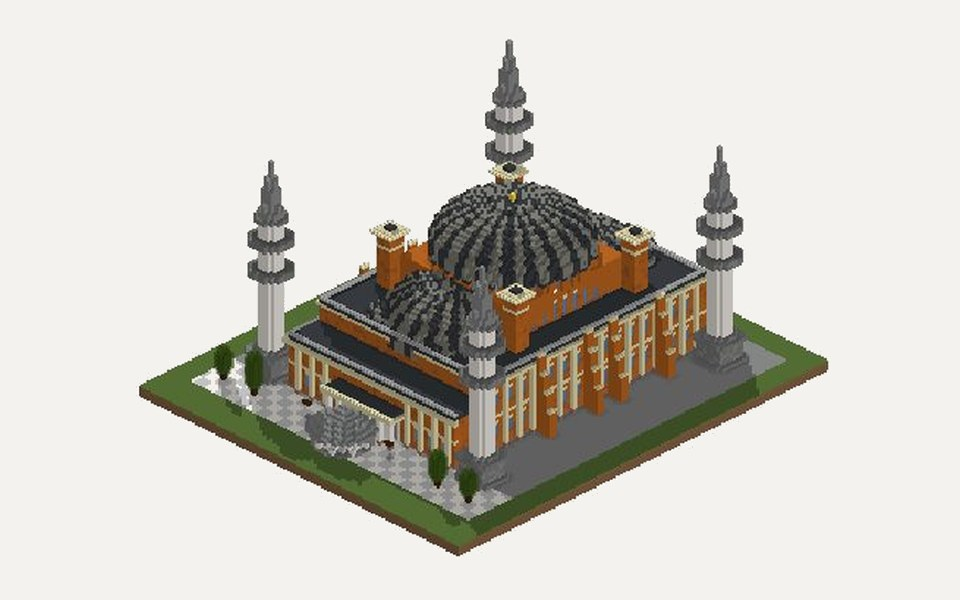 | *devasa bir Ayasofya camiinin tam aynısını yap, çok büyük olsun, ihtişamlı olsun*<br>"build a huge, majestic Hagia Sophia" | Opus 5.5 | 82 × 97, 64 blocks high, 44,000+ blocks: main dome with 40 windows, half domes, 4 minarets, mihrab, minbar, a courtyard with a fountain |
| 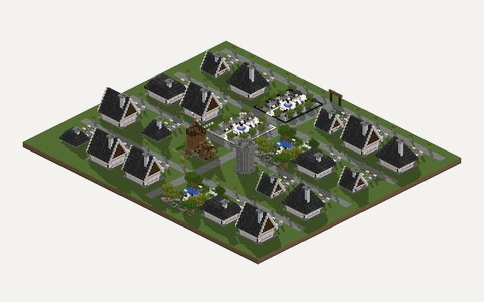 | *!opus önüme devasa bir İskandinav kasabası inşa et, hayallerdeki yaşam yeri olsun*<br>"a huge Scandinavian town, a dream place to live" | Opus 5.5 | 174 × 149: 18 furnished two-storey houses, 2 squares, 2 parks, a windmill, a watchtower, stone roads, street lamps, an entrance arch |
| 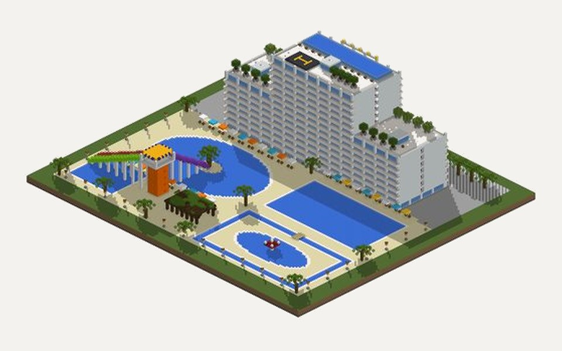 | *!opus devasa 5 yıldızlı aquaparklı her şey dahil ultra lüks bir otel yap*<br>"a giant 5-star all-inclusive hotel with an aquapark" | Opus 5.5 | a 14-storey tower and 8-storey wings, about 260 furnished rooms, lobby, restaurant, rooftop infinity pool and helipad; lagoon, wave pool, lazy river and a slide tower |
| 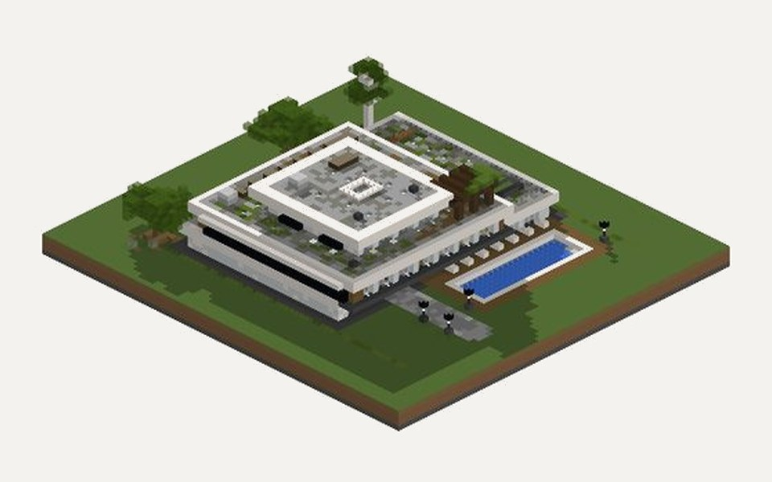 | *önüme acayip lüks bir modernist ev yap, içinde her türlü ev eşyası olsun*<br>"an insanely luxurious modernist house, fully furnished" | Opus 5.5 | 3 floors on 57 × 58, about 10,800 blocks: pool, terrace gardens and 18 furnished rooms including a gym and a library |
| 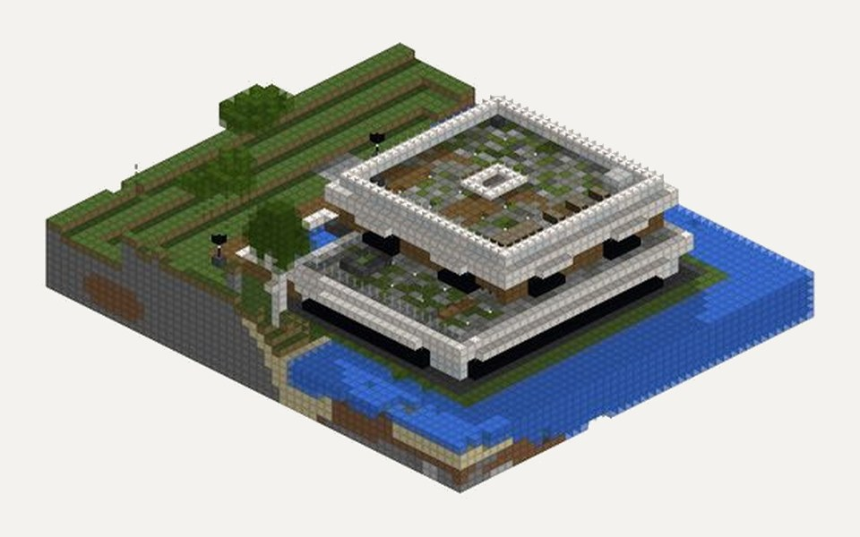 | *lüks bir ev yap* → *eşyalar nerede?* → *kapılar nerede?* → *tüm yapıyı baştan, kusursuz yap*<br>"build a luxury house" → "where's the furniture?" → "where are the doors?" → "redo it all, flawless" | Sonnet 5.5 → Opus 5.5 | furnished 8 rooms, then fitted 8 doors, then undid the old villa and built a new two-storey beach villa: 32,736 blocks, 9 doors, stairs, pool, 7 furnished rooms, no critical audit findings |
| 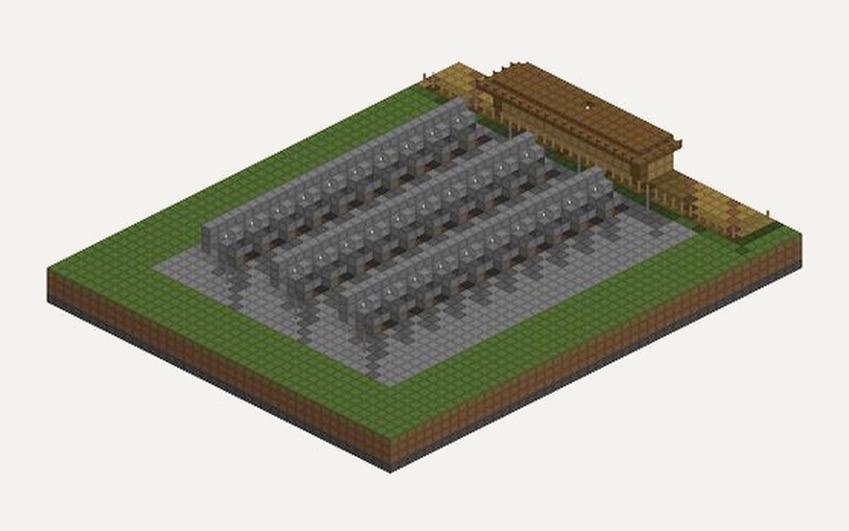 | *!sonnet daha iyisini yap, redstone sistemli olsun, otomatik toplasın*<br>"a better farm, with redstone, harvesting itself" | Sonnet 5.5 | an automatic melon and pumpkin farm on 28 × 36 with 30 redstone lanes: observers fire pistons, hoppers carry the drops to chests |
| 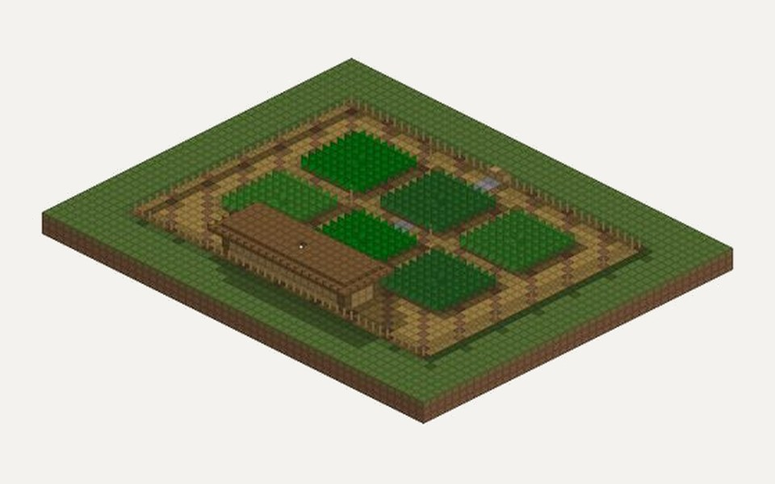 | *!sonnet önüme profesyonel bir Minecraft farmı yap, hemen çalışmaya başlasın*<br>"a professional farm that works right away" | Sonnet 5.5 | a 41 × 31 crop farm with wheat, carrots, potatoes and beetroot, irrigated and fenced, with a storage shed and composters |
| 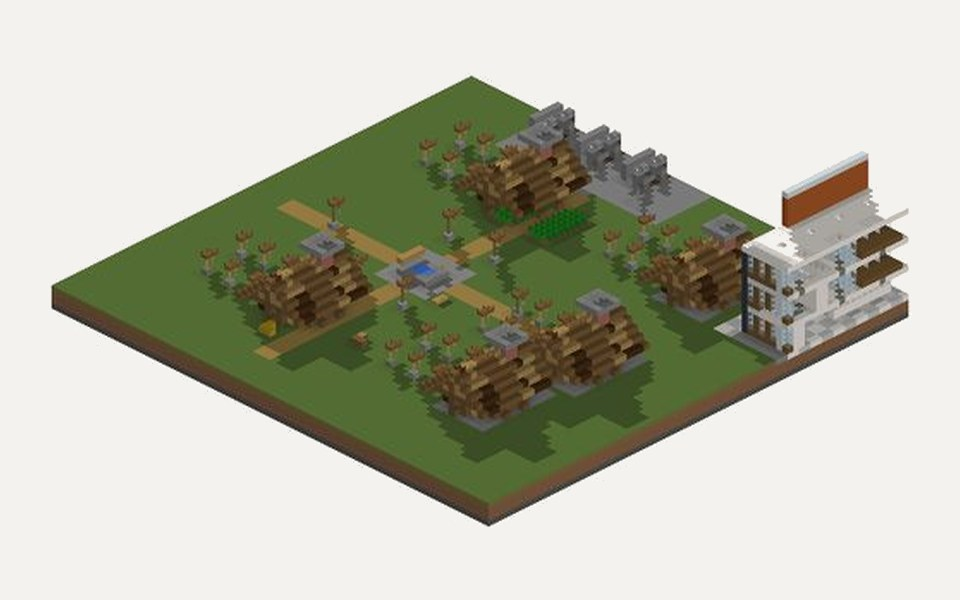 | *!haiku !düşük Minecraft köyünün aynısını yap*<br>"build a Minecraft village" | Haiku 5.5 | 5 rustic houses, a square with roads, a well, a bell, fields, hay bales and street lamps |
| 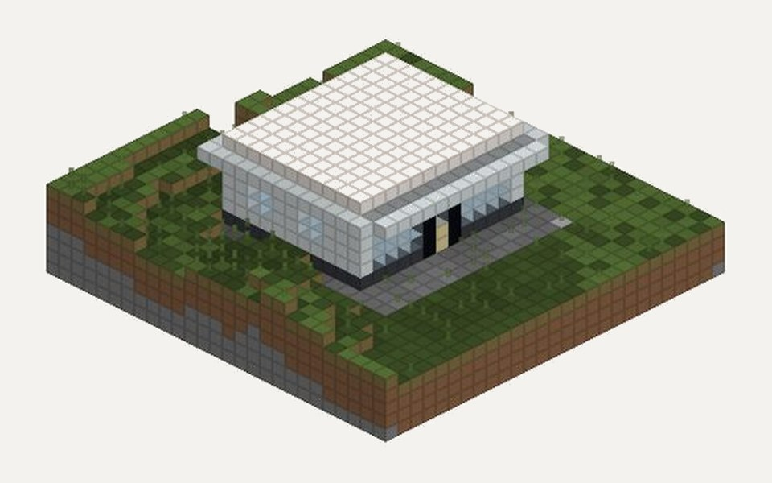 | *!sonnet !düşük ufak, kaliteli, kusursuz, minimalist modern bakkal*<br>"a small, flawless, minimalist corner shop" | Sonnet 5.5 | 13 × 11, 1,285 blocks: a wide glass shop window, shelves with goods and a till |
| 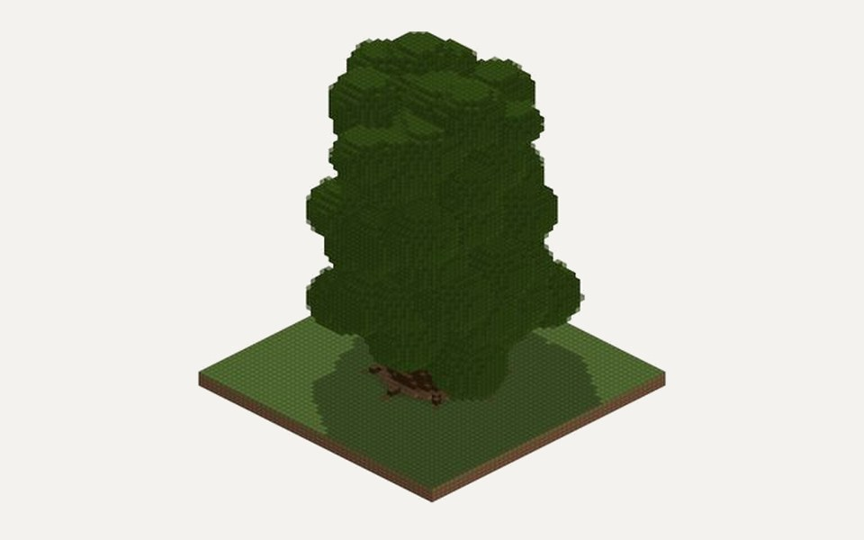 | *!haiku !düşük hiç düşünmeden önüme devasa bir ağaç yap*<br>"a gigantic tree, don't think, just build" | Haiku 5.5 | a 68 block high sequoia-like tree with a conical trunk, root buttresses and a wide crown |
| 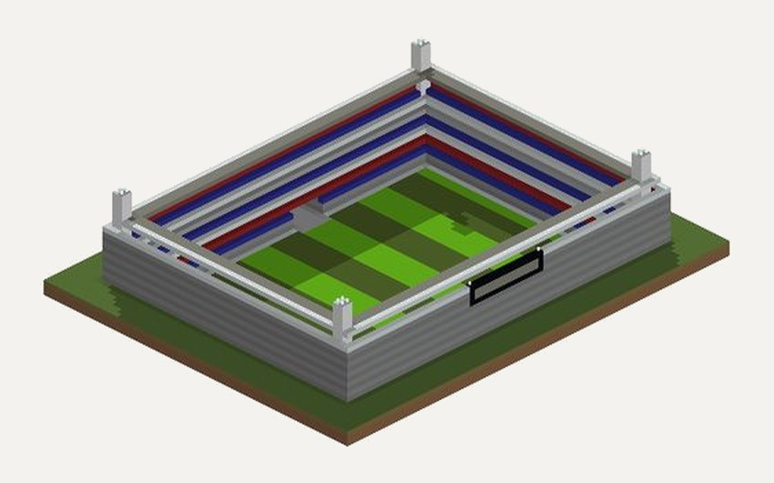 | *!haiku !düşük stadyum yap*<br>"build a stadium" | Haiku 5.5 | 50 × 66: pitch, 4-tier stands, floodlight towers in the corners, an entrance tunnel |
| 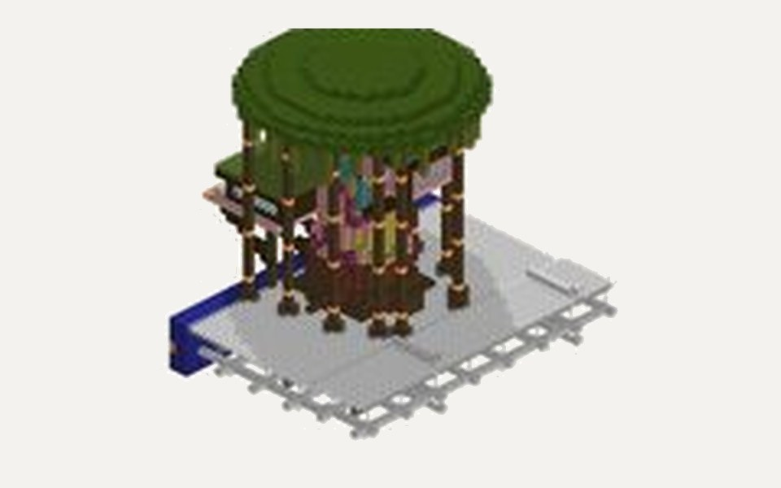 | *!opus !orta stadyum manzaralı ağaç ev yap, çatıdan maçı izleyelim*<br>"a tree house on the stadium roof to watch the match" | Opus 5.5 | a 39 block high tree house on the roof, 8,522 blocks |
| 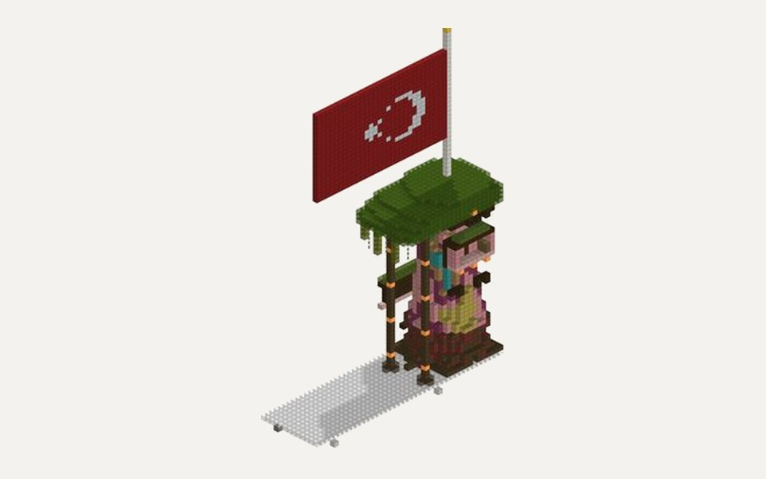 | *!opus !düşük üstüne Türk bayrağının aynısını dik*<br>"put up a Turkish flag on top" | Opus 5.5 | a 33 block quartz pole and a 30 × 20 flag made of red and white concrete |
| 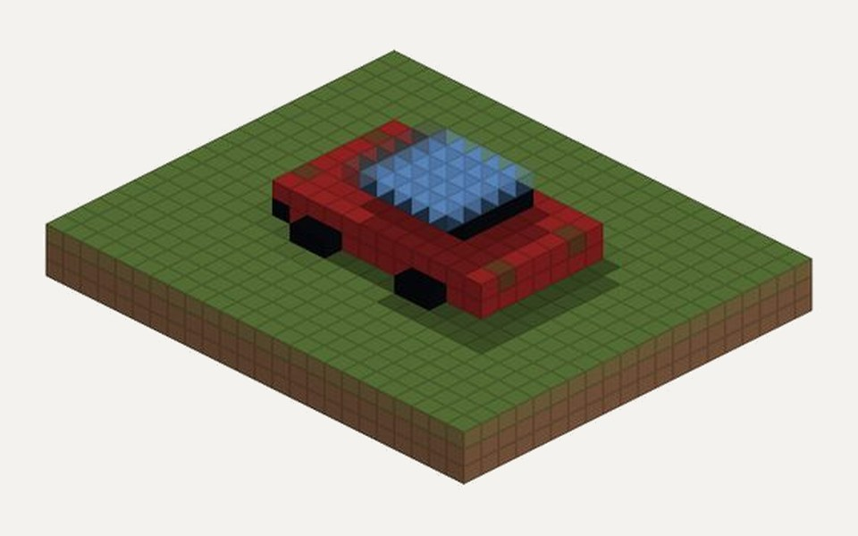 | *!haiku önüme bir araba yap*<br>"build me a car" | Haiku 5.5 | a 12 × 8 red sports car with a glass cabin, headlights and black wheels |

Usta also says what it could not do. It reports untested redstone ("the circuit was not tested in game"), says when a
landmark is an interpretation rather than an exact copy, and passes on audit warnings it could not clear.

## Install (Windows)

You need:

- Minecraft Java Edition with the official launcher
- Python 3.12 or newer (3.13 recommended) from [python.org](https://www.python.org/downloads/); tick
  **Add python.exe to PATH** while installing
- [Claude Code](https://claude.com/claude-code), installed once in PowerShell and logged in. Usta runs Claude through
  your own Claude account:
  ```powershell
  irm https://claude.ai/install.ps1 | iex
  claude auth login
  ```

Then:

1. Download **Usta-v0.1.0-Windows.zip** from
   [Releases](https://github.com/latentcore/usta-minecraft-claude/releases/latest) and extract it.
2. Close the Minecraft launcher and double-click **KUR.bat**.
3. Open the launcher, pick the **Usta (Claude)** profile and press Play.
4. The first time you use Usta in a world, press **Onayla ve yedekle** in chat (Usta backs the world up), then type
   `/claude önüme bir ev yap`.

The installer adds a separate **Usta (Claude)** launcher profile with its own game folder (`%USERPROFILE%\UstaOyun`),
so your normal installation and worlds are not touched. It installs Fabric, the mod, Fabric API and the performance
mods (Sodium, Lithium, FerriteCore) from their official sources with hash checks, sets up the bridge in a virtual
environment, and registers the MCP server for Claude Code. If Python or Claude Code is missing it says exactly what to
install. Running it again only fills in what is missing.

**From source.** A plain clone works too: if the mod has not been built, `KUR.bat` downloads the prebuilt jar from the
release and checks its SHA-256. To build it yourself, install JDK 25, point `JAVA_HOME` to it and run `gradlew build`
in `mod`.

| script | what it does |
|---|---|
| `KUR.bat` | install, or repair |
| `KALDIR.bat` | uninstall (worlds are moved to a backup, never deleted) |
| `DURUM.bat` | health check, every line green or red |
| `PANEL.bat` | local web panel: requests, jobs, undo, previews |
| `DUNYA_ICE_AKTAR.bat` | copy a world from your normal installation into the Usta profile |

## Commands

| command | |
|---|---|
| `/claude <request>` | build, edit or ask, in Turkish |
| `/claude !haiku !düşük <request>` | choose model and thinking level |
| `/usta geri` · `/usta yinele` | undo · redo |
| `/usta iptal` · `duraklat` · `sürdür` · `hız <sn>` | cancel, pause, resume, or set the build duration of the running job |
| `/usta foto` · `/usta harita` · `/usta panel` · `/usta durum` | a picture, a map, the web panel, status |
| `/ai undo` · `redo` · `cancel` · `status` … | English aliases |
| `/usta stadyum` · `/usta stadyum zorla` | the 14.4 million block arena |
| `/usta patlama hızlı` · `normal` · `eşik 500` | fast explosions on or off, and the TNT threshold |

## Safety

- The API listens on 127.0.0.1 only, behind a token stored in a file only your user can read. Requests with an
  `Origin` header are refused, and the API shuts down if you open the world to LAN.
- Only vanilla blocks and entities are written to the world. Mod data lives outside the world folder.
- Usta does not build over existing structures or protected regions unless you explicitly ask. Players, pets, named
  mobs and villagers are moved to safety.
- Every job is undoable, a backup is taken the first time Usta touches a world, and large removals need confirmation.
- Text found in the world (signs, books) is treated as data, never as instructions.

## Under the hood

- **Tick-budgeted build engine.** Big jobs are spread over game ticks with chunk tickets and a safe placement order,
  and redstone circuits are woken once when the job ends. That is how a 14.4 million block arena can go up while you
  watch.
- **Fast explosions, a stress test of the engine.** 256 or more touching TNT blocks are resolved in one pass instead of
  as thousands of separate entities: a 4 second fuse, a shock wave, a crater and vanilla damage. In a test with
  100,000 TNT the server stayed at 20 TPS. Smaller clusters stay vanilla, explosions are undoable like any other job,
  and `/usta patlama normal` turns the feature off.

## Documentation

[ARCHITECTURE.md](ARCHITECTURE.md) · [AJAN_REHBERI.md](AJAN_REHBERI.md) (the agent guide) ·
[TARZ_REHBERI.md](TARZ_REHBERI.md) (style guide) · [LISANSLAR.md](LISANSLAR.md) ·
[THIRD_PARTY_NOTICES.md](THIRD_PARTY_NOTICES.md)

The in-game text and most of the documentation are in Turkish.

## About the film

The film was recorded inside the game by a Fabric client game test that moves the camera one tick per frame and
saves every frame at 1920 × 1080, so the motion stays smooth no matter how slow the machine is. The stadium is built
live by the same code `/usta stadyum` runs, in watch mode so it goes up in stages, while the camera circles it.
The chat line, titles and gallery were added in the edit; the music is generated, not sampled.

## Notes

- This project was written with Claude Code (Claude Opus 5.5).
- Not affiliated with or endorsed by Mojang Studios, Microsoft or Anthropic. Minecraft is a trademark of Mojang
  Synergies AB. Claude is a trademark of Anthropic.
- Using Claude requires your own Claude account; requests count toward its usage.

## License

[MIT](LICENSE)
